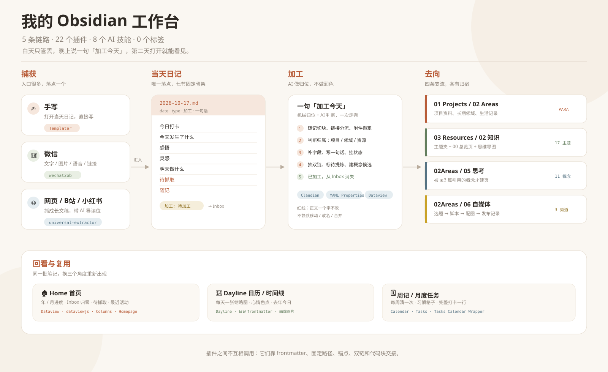

# 我的 Obsidian 工作台

> 5 条链路 · 22 个插件 · 8 个 AI 技能 · 0 个标签
>
> 白天只管丢，晚上说一句「加工今天」，第二天打开就能看见。

这套 Obsidian 不是「装了很多插件」的展示柜，而是我每天真的在跑的一套工作台。

它只解决三个问题：

- **入口太多**：微信、网页、视频、手机备忘录、随手写的句子，最后散在各处。
- **归位太累**：每条内容都要想「放哪个文件夹、打什么标签」。
- **回看太难**：日记写完就沉底，项目和知识区各长各的。

所以我把它拆成了 5 条链路。每条链路只回答一个问题：**东西从哪来、经过谁、最后在哪被看见。**

---

## 设计理念

### 1. 入口可以很多，收件箱只有一个

我不追求「所有东西都从一个按钮进来」，那在真实生活里很难做到。手写、微信、网页本来就是三种不同的动作。

但这些入口最终都会变成同一种状态：`加工: 待加工`。

所以每天只需要看一个地方：**Home 上的 Inbox 面板**。它不关心内容物理上在哪个文件夹，只关心「还有什么没处理」。

### 2. 目录管归属，字段管状态，双链管关系

- **目录**回答「这东西属于哪」：项目、长期领域、资源、归档。
- **字段**回答「它现在是什么状态」：`type` / `status` / `加工` / `项目`。
- **双链**回答「它和什么有关」：概念、人物、项目、日记。
- **标签**：0 个。

这不是为了极简而极简。我试过标签体系，最后它只会长成「同一个意思的七八种写法」。目录和字段已经能表达的东西，不再用标签重复一遍。

### 3. AI 只做搬运和判断，不改原文

这是整套工作台最重要的一条红线：

- 不去口癖、不加标点、不调语序；
- 不替用户决定「哪句话属于哪个小节」；
- 不静默移动、改名、合并、删除；
- 不推断心情，`mood` 留空就是留空。

AI 可以动的是：frontmatter、摘要块、`#待提炼` 标记、以及 `[[概念|原文片段]]` 这种「包一层链接、渲染出来和原文一模一样」的东西。

唯一的例外是机器自己写的「待抓取」两行：抓取完成后可以整体替换，因为那本来就不是人写的。

### 4. 插件之间不互相调用，它们靠「文件约定」协作

这是我觉得最值得分享的一点。

这套工作台里没有复杂的插件 API 串联。插件之间真正的接口是笔记本身：

- **frontmatter**：`加工` 字段决定它出不出现在 Inbox，`一句话` 被首页、Dayline、表格共同读取；
- **固定路径**：日记落在同一个日期目录，附件跟着当天日记走；
- **固定锚点**：微信永远追加到 `## 随记`；
- **双链**：概念页、项目页、知识页靠 `[[ ]]` 连起来；
- **代码块**：Dataview 查询、Mind Elixir 导图、DLink 画廊都是笔记里的一段文本。

所以换插件、升级插件，甚至换一个 AI，链路本身基本不用重写。**笔记是协议，插件只是客户端。**

---

## 30 秒看懂

| 时刻 | 我做什么 | 系统做什么 |
|---|---|---|
| 白天 | 往当天日记里写；微信发给自己；网页丢给 AI | 自动落到同一个「待加工」入口 |
| 晚上 | 说一句「加工今天」 | 归位、补字段、写摘要、抽双链、清中转区 |
| 第二天 | 打开 Home / Dayline | 看见昨天、这个月、待办和概念 |
| 每周 | 点一下 Calendar 的周数 | 生成周记，附带「每周清一次」清单 |
| 想输出时 | 打开一个自媒体内容页 | 选题、脚本、配图、视频、发布记录在同一页 |

---

## 链路 1｜捕获：入口可以很多，落点只有一个

**要解决的问题**：想法来的时候，不应该先做一道「放哪」的选择题。

### 怎么走

1. **手写**：打开当天日记，直接往七个固定小节里写。
2. **微信**：把文字、图片、语音、链接发给自己，插件自动追加到当天日记。
3. **网页 / 视频**：把链接丢给 AI，抓成长文稿，带 frontmatter 和折叠导读位。
4. **手机**：所有临时想法先丢进一个单文件 Inbox，回头统一清。

### 插件在这里做什么

| 环节 | 插件 / 工具 | 角色 |
|---|---|---|
| 新建日记 | **Templater** | 套七节骨架，按日期落到固定位置 |
| 微信捕获 | **WeChat2Ob** | 轮询微信，把消息追加到 `## 随记` |
| 网页 / B站 / 小红书 | **universal-extractor**（AI 技能） | 抓成长文稿，落到 Clippings |
| 找到今天 | **Dayline** | 从日历点进今天，或直接新建今日笔记 |
| 手机捕获 | Obsidian 手机端 + `Inbox.md` | 一个文件承接所有临时输入 |
| 网页参考 | **Custom Frames** | 豆包 / Kimi / 飞书 / BestBlogs 侧栏并排 |

### 效果

- 捕获时只需要做一件事：**写下来**。
- 所有入口最终都变成同一种状态，首页的 Inbox 是唯一需要看的清单。
- 微信里的链接不会丢在聊天记录里，而是变成日记里的「待抓取」，再变成库里的长文稿。

---

## 链路 2｜加工：AI 做归位，不做润色

**要解决的问题**：整理比记录还累；AI 一改原文，笔记就不再是自己的。

### 怎么走

晚上说一句「**加工今天**」，一次走完五步：

1. **机械归位**：随记切块、链接分流到「待抓取」、附件从中转区搬到当天日记的 `attachments/`。
2. **判断归属**：项目、长期领域、资源、归档，拿不准就停下来问。
3. **补全字段**：`type` / `status` / `项目` / `一句话`，缺什么补什么。
4. **抽取关系**：把成体系的概念包成双链，值得单独成篇的段落标 `#待提炼`。
5. **收尾**：`加工` 改成 `已加工`，它从首页 Inbox 消失。

### 8 个技能

| 说一句 | 会发生什么 |
|---|---|
| **加工今天** | 一篇日记的完整加工：字段、摘要、双链、待提炼、清中转区 |
| **加工微信** | 只处理微信来的消息，切成可读条目并归位 |
| **加工长文** | 给 Clippings 里的长文稿写折叠导读、抽概念 |
| **清空收件箱** | 把 `加工: 待加工` 的笔记逐条归位 |
| **抓灵感** | 把日记「待抓取」里的链接逐条抓成长文稿，并回填链接 |
| **概念提升** | 统计被反复提到但还没建页的概念，≥3 篇才建页 |
| **建总览** | 给一个文件夹生成统计、列表和思维导图 |
| **补一句话** | 给缺摘要的存量笔记补 `一句话` |

### 插件在这里做什么

| 步骤 | 插件 | 角色 |
|---|---|---|
| AI 加工入口 | **Claudian** | 在库内直接跑 Claude Code / Codex，读技能、改文件 |
| 字段编辑 | **YAML Properties** | frontmatter 可视化，改状态不用碰源码 |
| Inbox 视图 | **Dataview** | 把所有 `加工: 待加工` 聚成一张表 |
| 结构约定 | **Templater** | 保证每篇日记都有同样的七节和锚点 |
| 日期识别 | **Dayline** | 读 `date` 和 `一句话`，把日记放进时间线 |

### 效果

- 一天结束，首页 Inbox 归零；没归零就说明还有东西没处理。
- 每篇笔记都有可检索、可复用的 `一句话`，不再依赖「我还记得那篇标题」。
- 原文一个字没动，但多了一层可导航的结构：字段、双链、摘要、待提炼。

### 三条红线

1. **正文一个字不改**：不去口癖、不断句、不调语序、不替人分节。
2. **不静默移动 / 改名 / 合并**：要动先出清单。
3. **不推断心情**：`mood` 只由我自己填。

---

## 链路 3｜回看：一屏看完今天、这个月、这一年

**要解决的问题**：日记写完就沉底，任务、习惯、心情各在不同页面。

### 五个回看面

| 回看面 | 主要插件 | 回答什么问题 |
|---|---|---|
| **Home 首页** | Homepage + Dataview + Columns | 现在有什么没处理？今年过了多少？最近改了什么？ |
| **Dayline 日历 / 时间线** | Dayline | 这个月哪天写了？那天什么心情？去年今天在干嘛？ |
| **任务日历** | Tasks + Tasks Calendar Wrapper | 全库的待办分布在哪些天？ |
| **周记** | Calendar + Tasks | 这周做了什么？下周做什么？ |
| **月度打卡** | habit-tracker + 打卡-tracker | 习惯坚持了几天？完整打卡了几天？ |

### Home 上有什么

- 使用天数、笔记数、任务数；
- 年进度 / 月进度条；
- Important Days 倒计时；
- 最近编辑 / 最近创建；
- Inbox（`加工: 待加工`）；
- 待抓取（全库未抓链接 + 抓取失败）；
- 常用网址卡片。

首页不是「信息越多越好」，而是每天打开时能回答三个问题：**有什么没处理、现在到哪了、最近发生了什么。**

### Dayline 做了什么

Dayline 把日记从「一个文件」变成「一段时间」：

- 日历上每天一张缩略图；
- 有日记的日子有标记，有心情的日子有颜色；
- 时间线按天展开，能看到当天的一句话摘要；
- 「去年今日」把同一天的历史翻出来；
- 图片既认普通嵌入，也认 DLink 画廊里的图（用一个本地小补丁接上）。

### 效果

- 找东西不再靠翻文件夹，先看首页的 Inbox 和最近活动。
- 复盘不再靠回忆，日历、时间线、周记、月度打卡各给一个角度。
- 任务、习惯、心情、图片都在同一批日记上长出来，不需要重复录入。

---

## 链路 4｜沉淀：文件夹是仓库，总览页是地图

**要解决的问题**：知识区很容易变成「另一个更大的文件夹」。

### 怎么走

1. **建夹**：一个主题一个文件夹。
2. **建总览**：说一句「建总览」，生成 `00{主题}.md`。
3. **写概念**：日记里随手写 `[[概念]]`，不用管页面存不存在。
4. **概念提升**：被 ≥3 篇不同笔记引用的概念，才建独立页。
5. **同义归并**：一个意思两种写法，只加 `aliases`，不动源笔记。

### 总览页固定三块

| 块 | 由谁渲染 | 作用 |
|---|---|---|
| 统计 | Dataview | 每个子夹有多少篇 |
| 列表 | Dataview | 页面、类型、状态、一句话 |
| 思维导图 | Mind Elixir | 一眼看到主题结构，节点可点回笔记 |

### 插件在这里做什么

| 工具 / 机制 | 角色 |
|---|---|
| **Dataview** | 统计、列表、出现记录、待建页面 |
| **Mind Elixir** | 把文件夹结构渲染成可点的思维导图 |
| **Backlinks**（核心） | 当前页被谁引用、哪里提到了但没链接 |
| **aliases 字段** | 同一个概念的多种写法归到一页 |
| **Floating TOC** | 长笔记的悬浮目录 |
| **Better Mermaid**（Excalidraw 按需） | 流程图、结构图、手绘图 |

### 效果

- 17 个知识主题，每个都有自己的地图，而不是一层层点文件夹。
- 11 个概念页不是「一次性页面」，而是被反复引用后才长出来的。
- 0 个标签，也不会因为「这个词到底打什么标签」而卡住。

---

## 链路 5｜输出：从选题到发布，不离开库

**要解决的问题**：创作时最怕在笔记、图片文件夹、剪辑软件、发布后台之间来回切。

### 一页工作流

一个自媒体内容页固定五段：

1. **选题**：给谁看、他看完能拿走什么、钩子是什么。
2. **脚本 / 文案**：正文直接写。
3. **配图**：DLink 画廊，一行一张，封面放第一张。
4. **视频**：库外原片用 DLink 链接，能直接播放。
5. **发布记录**：发布状态、链接、日期回填。

### 插件在这里做什么

| 环节 | 插件 | 角色 |
|---|---|---|
| 新建内容页 | **Templater** | 套「选题 → 脚本 → 配图 → 视频 → 发布」模板 |
| 块编辑 | **Block Editor** | 块手柄、拖拽排序、斜杠命令 |
| 文本工具条 | **Editing Toolbar** | 不记 Markdown 语法也能排版 |
| 配图 | **DLink** | 瀑布流画廊；图片链接可以原地转成分栏组图 |
| 多栏排版 | **Columns** | 首页、月度任务、对照内容 |
| 发布字段 | **YAML Properties** | `发布状态` / `平台` / `发布` / `链接` |

### 效果

- 选题、脚本、配图、视频、发布记录在同一页，不用建五个文件。
- 图片跟笔记走：要跟着笔记被翻的图进库，只在剪辑时用的原片留在库外。
- 发布状态是一个字段，不是又一个标签；Dataview 可以直接筛「选题 / 在做 / 已发布」。

---

## 插件协作的 9 个交接点

真正让这套工作台跑起来的，不是单个插件，而是下面这些交接。

| 交接点 | 上游 | 下游 | 靠什么交接 |
|---|---|---|---|
| 新建日记 | Templater | WeChat2Ob / Dataview | 固定日期路径 + `## 随记` 锚点 |
| 微信落地 | WeChat2Ob | Dataview Inbox | `加工: 待加工` |
| 开始加工 | Dataview Inbox | Claudian + 技能 | 同一个字段，点开就能处理 |
| 摘要复用 | Claudian | Home / Dayline / 表格 | `一句话` |
| 附件归位 | WeChat2Ob | 当天日记的 `attachments/` | 路径 + 双链 |
| 画廊进日历 | DLink | Dayline | 代码块里的 `![[图片]]` |
| 周记生成 | Calendar | Tasks / 周记模板 | 周数 + `- [ ]` 任务语法 |
| 总览生成 | 建总览技能 | Dataview + Mind Elixir | `dataview` / `mindelixir` 代码块 |
| 概念成页 | 日记双链 | 概念页 + 反链 | wikilink + `aliases` |

这张表也是我判断「要不要加一个新插件」的标准：**它能不能接进已有的交接点？** 接不进来，再强也只是多一个孤岛。

---

## 22 个插件，各自只做一件事

| 插件 | 在这套工作台里的角色 | 主链路 |
|---|---|---|
| **Templater** | 七节日记骨架、10 个内容模板 | 捕获 / 输出 |
| **WeChat2Ob** | 微信消息自动落进当天日记 | 捕获 |
| **Dayline** | 日历、时间线、心情、去年今日 | 回看 |
| **Custom Frames** | 豆包 / Kimi / 飞书 / BestBlogs 侧栏 | 捕获 / 阅读 |
| **Dataview** | 全库查询、Inbox、总览列表、出现记录 | 加工 / 回看 / 沉淀 |
| **Homepage** | 打开 Obsidian 直接进首页 | 回看 |
| **Columns** | 首页、月度任务、对照内容的多栏布局 | 回看 |
| **Calendar** | 从周数生成周记 | 回看 |
| **Tasks** | 任务查询、完成日期、截止日期 | 回看 |
| **Tasks Calendar Wrapper** | 把全库任务摊到日历 / 时间线 | 回看 |
| **Editing Toolbar** | 可视化编辑工具条 | 写作 |
| **Block Editor** | 块手柄、拖拽、斜杠命令 | 输出 |
| **Floating TOC** | 长笔记悬浮目录 | 阅读 |
| **YAML Properties** | frontmatter 可视化编辑 | 加工 |
| **Excalidraw** | 手绘图、流程图，按需使用 | 沉淀 |
| **Better Mermaid** | Mermaid 图表增强 | 沉淀 |
| **Mind Elixir** | 思维导图代码块 | 沉淀 |
| **DLink** | 图片画廊、库外文件链接与播放 | 输出 |
| **Minimal Theme Settings** | Minimal 主题外观 | 全局 |
| **Style Settings** | 主题与样式变量 | 全局 |
| **Claudian** | 在库内跑 Claude Code / Codex | 加工 |
| **Kanban** | 看板，按需使用 | 备用 |

---

## 我刻意没做的三件事

### 1. 不做「全自动」

AI 负责搬运、判断、补字段，但**最后一跳一定留给人**：

- 分类拿不准时停下来问；
- 同义概念只出候选，不自动合并；
- 心情、项目归属、正文措辞，都不猜。

全自动看起来很酷，但一次错误归位就会让人不再信任整套系统。

### 2. 不让 AI 润色

我试过让 AI 去口癖、断句、调语序，甚至把原文拆进不同小节。结果是：**读起来更顺，但不再是自己的东西。**

所以这条链路被整个砍掉了。AI 只加结构，不改表达。

### 3. 不用标签

标签最大的问题不是「打错」，而是「同一个东西有太多正确写法」。目录、字段、双链已经足够表达归属、状态和关系。

0 标签不是洁癖，是减少每天要做的决定。

---

## 实际效果

| 指标 | 现在 |
|---|---|
| 日记 | 70+ 篇 |
| 笔记总量 | 400+ 篇 |
| 知识主题 | 17 个 |
| 概念页 | 11 个 |
| 长文稿 | 13 篇 |
| 内容模板 | 10 个 |
| AI 技能 | 8 个 |
| 社区插件 | 22 个 |
| 标签 | 0 个 |
| 动态视图 | 60+ 处 Dataview、20+ 张思维导图、12 个画廊 |

### 前后对比

| 以前 | 现在 |
|---|---|
| 微信收藏越堆越多 | 发给自己，晚上自动落到当天日记 |
| 找笔记靠搜索 | 首页看 Inbox、待抓取、最近活动 |
| 日记写完就沉底 | Dayline 日历 / 时间线 / 去年今日 |
| 知识区是文件夹 | 每个夹有总览页 + 思维导图 |
| 标签越打越乱 | 0 标签，目录 + 字段 + 双链 |
| 创作散在多个 App | 一页走完选题 → 发布 |

---

## 界面截图

这套工作台最值得看的不是配置，而是几个界面放在一起时的「接力感」。

这四张最能说明问题：

| 截图 | 拍什么 | 能说明什么 |
|---|---|---|
| `assets/screenshots/home.png` | Home 首屏 | 统计、Inbox、待抓取、最近活动在一屏 |
| `assets/screenshots/dayline.png` | Dayline 日历 + 时间线 | 日记变成可回看的时间 |
| `assets/screenshots/process.png` | 加工前后对比 | AI 只加结构，不改原文 |
| `assets/screenshots/output.png` | 自媒体内容页 + 画廊 | 选题到发布在同一页 |

图片放在 `assets/screenshots/`，命名对应即可。

<!--
截图放好后，把下面这段的注释去掉：

-->

---

## 想复刻？先读这五条

1. **先定目录语义，再选插件。** 不知道东西该放哪，装再多插件也只是把混乱搬家。
2. **先跑通一条链路，再加下一条。** 先把「捕获 → 当天日记 → 加工」跑顺，再考虑日历、打卡、输出。
3. **插件之间用文件约定协作。** frontmatter、固定路径、锚点、双链、代码块，比插件 API 稳得多。
4. **给 AI 写红线，比写提示词更重要。** 「不许改什么」比「请帮我整理」更能决定系统好不好用。
5. **留一个人工确认点。** 全自动的尽头，往往是一次错误归位之后整套系统被弃用。

---

## 参考与致谢

这套工作台站在很多人的肩膀上：

- [IvyChim/Obsidian-Template](https://github.com/IvyChim/Obsidian-Template)：PARA + Periodic Notes 的目录骨架、Home、Calendar、Habit Tracker 的起点。
- [Haoo-7/Obsidian-Dayline](https://github.com/Haoo-7/Obsidian-Dayline)：把日记变成日历、时间线和「去年今日」。
- [Claudian](https://github.com/YishenTu)：在 Obsidian 里直接跑 Claude Code / Codex。
- [MarcBolo](https://github.com/MarcBolo) 的 DLink / Block Editor：图片画廊与块编辑。
- WeChat2Ob：微信到 Obsidian 的自动捕获。
- 以及所有插件的作者。

> 本文只讲工作流与插件协作方式，不包含 vault 模板、插件配置和脚本。
