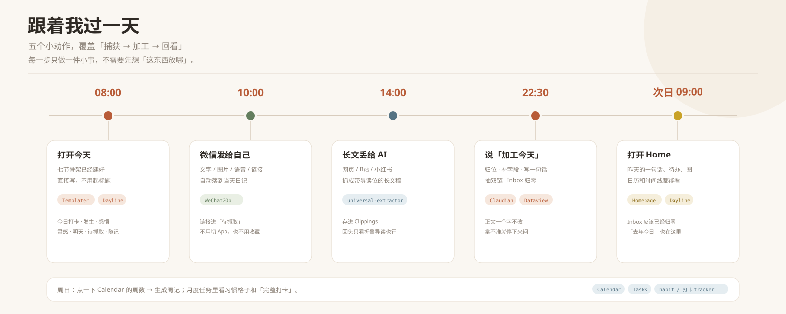
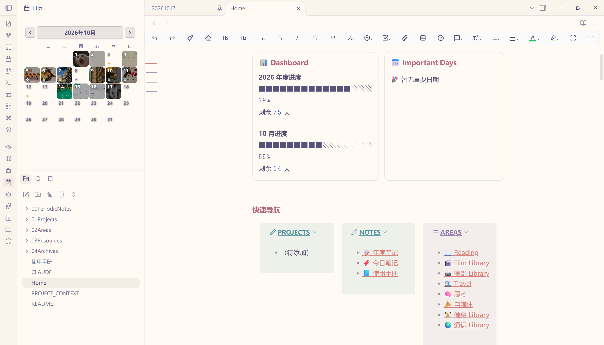

# 我的一天，是怎么在 Obsidian 里跑完的

> 白天随手丢，晚上说一句「加工今天」，第二天打开就能看见。

如果你也这样：微信收藏一堆、浏览器开十几个标签、日记写完就再没翻过——这套工作台就是为这个做的。

它不要求你先学会一套分类法，也不要求每天花半小时整理。一天里真正需要我出现的，只有三个动作：**写、发、说一句话。**

---

## 08:00 打开今天，直接写

打开 Obsidian，首页就是 Home。点 Dayline 里的今天，或者按 `Ctrl+P` 搜「今日笔记」。

Templater 已经把七个小节建好：

`今日打卡` / `今天发生了什么` / `感悟` / `灵感` / `明天做什么` / `待抓取` / `随记`

不用想起标题、不用选文件夹、不用打标签。语音转文字、一整段没分段、写到一半停下，都可以。

> 背后：**Templater** 建骨架，**Dayline** 定位今天，**Homepage** 打开就进首页。

## 10:00 微信发给自己

看到一条想存的东西，直接在微信里发给自己。

WeChat2Ob 会自动把它追加到当天日记的 `## 随记`；带链接的进 `## 待抓取`；图片、语音、文件先进中转区。

这一步只解决「别丢」，不解决「放哪」。分类留到晚上。

> 背后：**WeChat2Ob**。

## 14:00 长文丢给 AI

网页、公众号、B站、小红书，说一句「保存这篇文章」，或者攒着晚上说「抓灵感」。

系统会抓成一篇 Markdown 长文稿，带 frontmatter 和一个默认折叠的 AI 导读。打开先看导读，感兴趣再展开全文。

> 背后：**universal-extractor** + 「加工长文」技能。

## 22:30 说一句「加工今天」

这是每天唯一必须做的整理动作。

Claudian 会读当天日记，然后：

1. 把随记里的成块内容按空行搬到对应位置，链接分流到「待抓取」，附件搬到当天日记的 `attachments/`；
2. 判断每条内容属于项目、长期领域、资源还是归档；
3. 补上 `type` / `status` / `项目` / `一句话`；
4. 把成体系的概念包成 `[[双链]]`，值得单独成篇的段落标 `#待提炼`；
5. 把 `加工` 改成 `已加工`，它从首页 Inbox 消失。

**它不改正文。** 不去口癖、不断句、不调语序、不替人分节。拿不准的分类会停下来问，心情也不会猜。

> 背后：**Claudian** + 8 个技能 + **YAML Properties** + **Dataview**。

## 次日 09:00 打开 Home

首页会告诉我：

- 有什么没处理（Inbox 应该已经归零）；
- 有哪些链接还没抓（待抓取）；
- 今年 / 这个月过了多少；
- 最近改了什么、建了什么；
- 有哪些重要日子快到了。

点 Dayline，能看到日历上的每天缩略图、心情色点、时间线，以及「去年今日」。

> 背后：**Homepage**、**Dataview**、**Columns**、**Dayline**。

## 周日：顺手复盘

点 Calendar 上的周数，生成一篇周记。模板里自带一张「每周顺手清一次」清单：

- 清空收件箱；
- 把攒着的链接抓掉；
- 跑一次「概念提升」。

月度任务页里还有习惯格子和「完整打卡」一行，数据都来自每天的日记，不用重复录。

> 背后：**Calendar**、**Tasks**、**Tasks Calendar Wrapper**、习惯 / 打卡脚本。

---

除了每天，另外两件事也走同一套结构：**做内容**和**沉淀知识**。

## 想输出的时候：一页从选题到发布

做内容时，打开一个自媒体内容页，模板已经分好五段：

1. **选题**：给谁看、他看完能拿走什么、钩子是什么；
2. **脚本 / 文案**；
3. **配图**：DLink 画廊，一行一张，封面放第一张；
4. **视频**：库外原片用 DLink 链接，能直接播放；
5. **发布记录**：发布状态、链接、日期。

选题、脚本、配图、视频、发布记录都在同一页，不用建五个文件。

> 背后：**Templater** 建页，**DLink** 放图，**Block Editor** 调整块，**YAML Properties** 回填发布字段。

## 平时：想法怎么长成页面

日记里想到一个概念，随手写 `[[主动记忆]]`，不用管页面存不存在。等它被 3 篇以上不同笔记引用，说一句「概念提升」，才会在 `02Areas/05思考/` 建页。

知识区也一样：一个主题一个文件夹，说一句「建总览」，就能得到统计、列表和一张可点的思维导图。

> 背后：**Dataview** 统计，**Mind Elixir** 画图，**Backlinks** 看谁引用过。

---

## 这套流程为什么能跑通

### 1. 先落到今天，再决定去哪

捕获的时候不想分类，分类的时候不打断捕获。中间那一晚，就是缓冲。

### 2. 目录管归属，字段管状态，双链管关系

- 目录：项目、长期领域、资源、归档；
- 字段：`type` / `status` / `加工` / `项目`；
- 双链：概念、人物、项目、日记；
- 标签：0 个。

标签最大的问题不是打错，而是同一个东西有太多正确写法。目录和字段已经够用，就不再增加每天要做的决定。

### 3. AI 只搬运和补结构，不改原文

AI 可以动 frontmatter、摘要块、`#待提炼` 标记、`[[概念|原文片段]]`。除此之外，正文一个字不改。

### 4. 插件之间不互相调用，它们看同一篇笔记

这是整套东西最关键的「胶水」：

- `加工: 待加工` 决定它出不出现在 Inbox；
- `一句话` 被首页、Dayline、表格共同读取；
- 固定路径让附件跟着当天日记走；
- `## 随记` 是微信的落点；
- Dataview、Mind Elixir、DLink 都是笔记里的一段代码块。

**笔记是协议，插件只是客户端。** 所以换插件、升级插件，链路基本不用重写。

---

## 系统全景

把上面的动作连起来，就是一条很短的流水线：**捕获 → 当天日记 → 加工 → 去向 → 回看**。

想看完整的大图，可以打开 [`assets/workflow-map.svg`](assets/workflow-map.svg)。

---

## 每个动作背后是谁

| 我做的动作 | 背后是谁 | 它做了什么 |
|---|---|---|
| 打开今天 | Templater + Dayline + Homepage | 建七节骨架、定位今天、打开首页 |
| 微信发给自己 | WeChat2Ob | 落到随记 / 待抓取 |
| 保存一篇长文 | universal-extractor | 抓成 Markdown 长文稿 |
| 说「加工今天」 | Claudian + 8 个技能 | 归位、补字段、写摘要、抽双链 |
| 第二天回看 | Home + Dayline | 统计、日历、时间线、去年今日 |
| 周日复盘 | Calendar + Tasks | 周记、任务、习惯、打卡 |
| 做一条内容 | Templater + DLink + Block Editor | 选题、脚本、配图、发布记录 |
| 想到一个概念 | 「概念提升」技能 | 被 ≥3 篇引用才建页，顺手归并同义词 |
| 给文件夹建地图 | 「建总览」技能 + Mind Elixir | 统计、列表、可点的思维导图 |

### 8 个技能，8 句话

| 说一句 | 会发生什么 |
|---|---|
| **加工今天** | 一篇日记的完整加工：字段、摘要、双链、待提炼、清中转区 |
| **加工微信** | 只处理微信来的消息，切成可读条目并归位 |
| **加工长文** | 给长文稿写折叠导读、抽概念 |
| **清空收件箱** | 把待加工的笔记逐条归位 |
| **抓灵感** | 把「待抓取」里的链接逐条抓成长文稿，并回填链接 |
| **概念提升** | 被 ≥3 篇引用的概念才建页，顺手归并同义词 |
| **建总览** | 给一个文件夹生成统计、列表和思维导图 |
| **补一句话** | 给缺摘要的存量笔记补 `一句话` |

---

## 用了哪些插件

按用途分组（22 个社区插件）：

| 用途 | 插件 |
|---|---|
| 捕获 | Templater、WeChat2Ob、Custom Frames |
| 加工 | Claudian、YAML Properties、Dataview |
| 回看 | Homepage、Dayline、Calendar、Tasks、Tasks Calendar Wrapper、Columns |
| 沉淀 | Mind Elixir、Floating TOC、Better Mermaid、Excalidraw |
| 输出 | DLink、Block Editor、Editing Toolbar |
| 外观 | Minimal Theme Settings、Style Settings |
| 备用 | Kanban |

展开：每个插件具体负责什么

| 插件 | 在这套工作台里的角色 |
|---|---|
| **Templater** | 七节日记骨架、10 个内容模板 |
| **WeChat2Ob** | 微信消息自动落进当天日记 |
| **Custom Frames** | 豆包 / Kimi / 飞书 / BestBlogs 侧栏 |
| **Claudian** | 在库内直接跑 Claude Code / Codex |
| **YAML Properties** | frontmatter 可视化编辑 |
| **Dataview** | 全库查询、Inbox、总览列表、出现记录 |
| **Homepage** | 打开 Obsidian 直接进首页 |
| **Dayline** | 日历、时间线、心情、去年今日 |
| **Calendar** | 从周数生成周记 |
| **Tasks** | 任务查询、完成日期、截止日期 |
| **Tasks Calendar Wrapper** | 把全库任务摊到日历 / 时间线 |
| **Columns** | 首页、月度任务、对照内容的多栏布局 |
| **Mind Elixir** | 思维导图代码块 |
| **Floating TOC** | 长笔记悬浮目录 |
| **Better Mermaid** | Mermaid 图表增强 |
| **Excalidraw** | 手绘图、流程图，按需使用 |
| **DLink** | 图片画廊、库外文件链接与播放 |
| **Block Editor** | 块手柄、拖拽、斜杠命令 |
| **Editing Toolbar** | 可视化编辑工具条 |
| **Minimal Theme Settings** | Minimal 主题外观 |
| **Style Settings** | 主题与样式变量 |
| **Kanban** | 看板，按需使用 |

展开：插件之间的 9 个交接点

| 交接点 | 上游 | 下游 | 靠什么交接 |
|---|---|---|---|
| 新建日记 | Templater | WeChat2Ob / Dataview | 固定日期路径 + `## 随记` 锚点 |
| 微信落地 | WeChat2Ob | Dataview Inbox | `加工: 待加工` |
| 开始加工 | Dataview Inbox | Claudian + 技能 | 同一个字段 |
| 摘要复用 | Claudian | Home / Dayline / 表格 | `一句话` |
| 附件归位 | WeChat2Ob | 当天日记的 `attachments/` | 路径 + 双链 |
| 画廊进日历 | DLink | Dayline | 代码块里的 `![[图片]]` |
| 周记生成 | Calendar | Tasks / 周记模板 | 周数 + `- [ ]` 任务语法 |
| 总览生成 | 建总览技能 | Dataview + Mind Elixir | `dataview` / `mindelixir` 代码块 |
| 概念成页 | 日记双链 | 概念页 + 反链 | wikilink + `aliases` |

---

## 跑起来之后

| 指标 | 现在 |
|---|---|
| 日记 | 70+ 篇 |
| 笔记总量 | 400+ 篇 |
| 知识主题 | 17 个 |
| 概念页 | 11 个 |
| 长文稿 | 13 篇 |
| 内容模板 | 10 个 |
| AI 技能 | 8 个 |
| 社区插件 | 22 个 |
| 标签 | 0 个 |
| 动态视图 | 60+ 处 Dataview、20+ 张思维导图、12 个画廊 |

### 前后对比

| 以前 | 现在 |
|---|---|
| 微信收藏越堆越多 | 发给自己，晚上自动落到当天日记 |
| 找笔记靠搜索 | 首页看 Inbox、待抓取、最近活动 |
| 日记写完就沉底 | Dayline 日历 / 时间线 / 去年今日 |
| 知识区是文件夹 | 每个夹有总览页 + 思维导图 |
| 标签越打越乱 | 0 标签，目录 + 字段 + 双链 |
| 创作散在多个 App | 一页走完选题 → 发布 |

---

## 界面截图

这套工作台最值得看的不是配置，而是几个界面放在一起时的「接力感」。

| 截图 | 拍什么 | 能说明什么 |
|---|---|---|
| `assets/screenshots/home.png` | Home 首屏 | 统计、Inbox、待抓取、最近活动在一屏 |
| `assets/screenshots/dayline.png` | Dayline 日历 + 时间线 | 日记变成可回看的时间 |
| `assets/screenshots/process.png` | 加工前后对比 | AI 只加结构，不改原文 |
| `assets/screenshots/output.png` | 自媒体内容页 + 画廊 | 选题到发布在同一页 |

图片放在 `assets/screenshots/`，命名对应即可。截图时用示例日记，别把真实日记、客户名、面试进度或私人聊天截进去。

<!--
图片放好后，把下面这段的注释去掉：

-->

---

## 想复刻？先读这五条

1. **先定目录语义，再选插件。** 不知道东西该放哪，装再多插件也只是把混乱搬家。
2. **先跑通一天，再加功能。** 先把「打开今天 → 微信落地 → 晚上加工 → 第二天回看」跑顺，再考虑知识区、自媒体、打卡。
3. **插件之间用文件约定协作。** frontmatter、固定路径、锚点、双链、代码块，比插件 API 稳得多。
4. **给 AI 写红线，比写提示词更重要。** 「不许改什么」比「请帮我整理」更能决定系统好不好用。
5. **留一个人工确认点。** 全自动的尽头，往往是一次错误归位之后整套系统被弃用。

---

## 参考与致谢

这套工作台站在很多人的肩膀上：

- [IvyChim/Obsidian-Template](https://github.com/IvyChim/Obsidian-Template)：PARA + Periodic Notes 的目录骨架、Home、Calendar、Habit Tracker 的起点。
- [Haoo-7/Obsidian-Dayline](https://github.com/Haoo-7/Obsidian-Dayline)：把日记变成日历、时间线和「去年今日」。
- [Claudian](https://github.com/YishenTu)：在 Obsidian 里直接跑 Claude Code / Codex。
- [MarcBolo](https://github.com/MarcBolo) 的 DLink / Block Editor：图片画廊与块编辑。
- WeChat2Ob：微信到 Obsidian 的自动捕获。
- 以及所有插件的作者。

> 本文只讲工作流与插件协作方式，不包含 vault 模板、插件配置和脚本。
