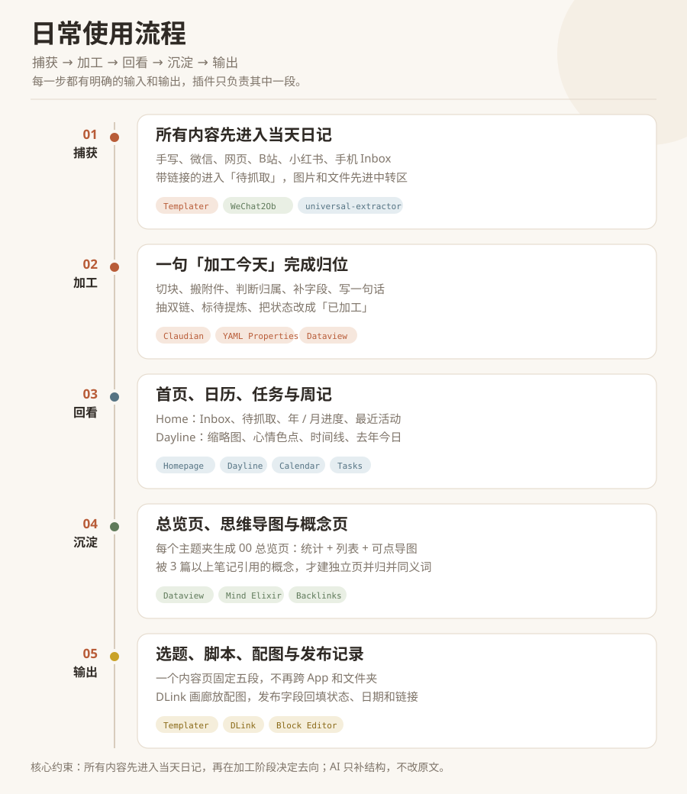

# Obsidian 工作台：以日记为入口的五条使用链路

> 捕获 → 加工 → 回看 → 沉淀 → 输出
>
> 22 个插件，8 个 AI 技能，0 个标签。

这套工作台以当天日记为统一入口，把分散在微信、网页、视频和手写里的内容收拢到一起。晚上用一句「加工今天」完成归位和结构化，第二天通过首页、日历和时间线回看。

它不要求先建立复杂的分类体系，也不依赖标签。核心目标是减少「这条内容放哪」和「上次写到哪」的成本。

## 核心亮点

| 亮点 | 做法 | 效果 |
|---|---|---|
| 一个收件箱 | 所有未处理内容统一标记 `加工: 待加工`，首页聚合 | 不需要记住内容放在哪 |
| AI 只做归位 | 只修改笔记字段、摘要、双链 | 原文保持原样 |
| 0 标签 | 目录管归属，字段管状态，双链管关系 | 减少每天的分类决策 |
| 插件靠笔记协作 | 笔记字段、固定路径、锚点、代码块 | 换插件不需要重写链路 |
| 多个回看入口 | Home、Dayline、Tasks、周记、月度打卡 | 日记不会写完就沉底 |
| 输出闭环 | 选题、脚本、配图、发布记录在同一页 | 内容生产不跨 App |

---

## 一、捕获：所有内容先进入当天日记

捕获阶段不做分类，只保证内容不丢。

| 入口 | 方式 | 结果 |
|---|---|---|
| 手写 | 打开当天日记，直接写 | Templater 已生成七节骨架 |
| 微信 | 把文字、图片、语音、链接发给自己 | WeChat2Ob 追加到 `## 随记`，链接进入 `## 待抓取` |
| 网页 / 视频 | 说「保存这篇文章」或「抓灵感」 | universal-extractor 抓成 Markdown 长文稿 |
| 手机 | 临时内容先丢进 `Inbox.md` | 回头统一清理 |

当天日记固定包含七个小节：`今日打卡` / `今天发生了什么` / `感悟` / `灵感` / `明天做什么` / `待抓取` / `随记`。写的时候不需要起标题、选文件夹或打标签。

涉及的插件：**Templater**、**WeChat2Ob**、**Dayline**、**Homepage**、**Custom Frames**。

---

## 二、加工：一句「加工今天」完成归位

这是每天唯一必须执行的整理动作。Claudian 读取当天日记后，依次完成：

1. 把随记里的成块内容按空行搬到对应位置，链接分流到「待抓取」，附件搬到当天日记的 `attachments/`；
2. 判断每条内容属于项目、长期领域、资源还是归档；
3. 补上 `type` / `status` / `项目` / `一句话`；
4. 把成体系的概念包成 `[[双链]]`，值得单独成篇的段落标 `#待提炼`；
5. 把 `加工` 改成 `已加工`，该日记从首页 Inbox 消失。

### 三条红线

- 正文一个字不改：不去口癖、不断句、不调语序、不替使用者分节；
- 不静默移动、改名、合并或删除，要动先出清单；
- 不推断心情，`mood` 留空就是留空。

涉及的插件：**Claudian**、**YAML Properties**、**Dataview**。

---

## 三、回看：首页、日历、任务与周记

同一批日记会以不同角度重新出现：

| 回看面 | 内容 | 解决的问题 |
|---|---|---|
| **Home** | Inbox、待抓取、年 / 月进度、最近活动、重要日期 | 现在有什么没处理 |
| **Dayline** | 日历缩略图、心情色点、时间线、去年今日 | 这段时间过得怎么样 |
| **Tasks + Tasks Calendar Wrapper** | 全库待办摊到日历和时间线 | 任务分布在哪些天 |
| **Calendar 周记** | 周记模板 + 「每周顺手清一次」清单 | 下周要做什么 |
| **月度任务** | 习惯格子 + 「完整打卡」一行 | 习惯坚持得怎么样 |

涉及的插件：**Homepage**、**Dataview**、**Columns**、**Dayline**、**Calendar**、**Tasks**、**Tasks Calendar Wrapper**。

---

## 四、沉淀：总览页、思维导图与概念页

知识区不依靠标签，而是依靠「文件夹 + 总览页 + 双链」。

- **建总览**：给一个主题文件夹生成 `00{主题}.md`，固定包含统计、列表和 Mind Elixir 思维导图；
- **概念提升**：日记里写下的 `[[概念]]`，被 3 篇以上不同笔记引用后才建独立页；
- **同义归并**：一个意思多种写法时，只添加 `aliases`，不修改源笔记。

涉及的插件：**Dataview**、**Mind Elixir**、**Backlinks**、**Floating TOC**、**Better Mermaid**、**Excalidraw**。

---

## 五、输出：选题、脚本、配图与发布记录

一个自媒体内容页固定五段：

1. 选题：给谁看、看完能拿走什么、钩子是什么；
2. 脚本 / 文案；
3. 配图：DLink 画廊，一行一张，封面放第一张；
4. 视频：库外原片用 DLink 链接，能直接播放；
5. 发布记录：发布状态、链接、日期。

选题、脚本、配图、视频和发布记录都在同一页，不需要拆成多个文件。

涉及的插件：**Templater**、**DLink**、**Block Editor**、**Editing Toolbar**、**YAML Properties**。

---

## 为什么这样设计

### 1. 先捕获，后分类

捕获时不打断思路，分类统一放到晚上。中间那一天就是缓冲。

### 2. 目录管归属，字段管状态，双链管关系

- 目录：项目、长期领域、资源、归档；
- 字段：`type` / `status` / `加工` / `项目`；
- 双链：概念、人物、项目、日记；
- 标签：0 个。

标签的主要问题是同一个概念存在多种写法。目录和字段已经能表达归属与状态，就不再增加一层需要维护的分类。

### 3. AI 只补结构，不改原文

AI 可以修改 frontmatter、摘要块、`#待提炼` 标记和 `[[概念|原文片段]]`。除此之外，正文保持不变。

### 4. 插件之间通过笔记本身交接

这套工作台没有复杂的插件 API 串联，插件之间主要依靠以下约定协作：

- `加工: 待加工` 决定内容是否出现在 Inbox；
- `一句话` 被首页、Dayline 和表格共同读取；
- 固定路径让附件跟随当天日记；
- `## 随记` 是微信内容的落点；
- Dataview、Mind Elixir、DLink 都是笔记中的代码块。

因此，升级或替换插件时，大部分链路不需要重写。

如果需要查看完整的系统结构图，可以打开 [`assets/workflow-map.svg`](assets/workflow-map.svg)。

---

## 每个动作对应的插件

| 动作 | 主要插件 | 作用 |
|---|---|---|
| 打开今天 | Templater + Dayline + Homepage | 生成七节骨架、定位当天、打开首页 |
| 微信发给自己 | WeChat2Ob | 写入随记 / 待抓取 |
| 保存长文 | universal-extractor | 抓成 Markdown 长文稿 |
| 加工今天 | Claudian + 8 个技能 | 归位、补字段、写摘要、抽双链 |
| 第二天回看 | Home + Dayline | 统计、日历、时间线、去年今日 |
| 周日复盘 | Calendar + Tasks | 周记、任务、习惯、打卡 |
| 做一条内容 | Templater + DLink + Block Editor | 选题、脚本、配图、发布记录 |
| 建概念页 | 概念提升技能 | 被 3 篇以上引用才建页 |
| 建主题总览 | 建总览技能 + Mind Elixir | 统计、列表、思维导图 |

### 8 个技能

| 说一句 | 执行内容 |
|---|---|
| **加工今天** | 一篇日记的完整加工：字段、摘要、双链、待提炼、清中转区 |
| **加工微信** | 只处理微信消息，切成可读条目并归位 |
| **加工长文** | 给长文稿写折叠导读、抽概念 |
| **清空收件箱** | 把待加工笔记逐条归位 |
| **抓灵感** | 把「待抓取」链接逐条抓成长文稿，并回填链接 |
| **概念提升** | 被 3 篇以上引用的概念才建页，顺手归并同义词 |
| **建总览** | 给文件夹生成统计、列表和思维导图 |
| **补一句话** | 给缺摘要的存量笔记补 `一句话` |

---

## 插件清单

按用途分组，共 22 个社区插件：

| 用途 | 插件 |
|---|---|
| 捕获 | Templater、WeChat2Ob、Custom Frames |
| 加工 | Claudian、YAML Properties、Dataview |
| 回看 | Homepage、Dayline、Calendar、Tasks、Tasks Calendar Wrapper、Columns |
| 沉淀 | Mind Elixir、Floating TOC、Better Mermaid、Excalidraw |
| 输出 | DLink、Block Editor、Editing Toolbar |
| 外观 | Minimal Theme Settings、Style Settings |
| 备用 | Kanban |

展开：每个插件的具体职责

| 插件 | 职责 |
|---|---|
| **Templater** | 七节日记骨架、10 个内容模板 |
| **WeChat2Ob** | 微信消息自动写入当天日记 |
| **Custom Frames** | 豆包 / Kimi / 飞书 / BestBlogs 侧栏 |
| **Claudian** | 在库内运行 Claude Code / Codex |
| **YAML Properties** | frontmatter 可视化编辑 |
| **Dataview** | 全库查询、Inbox、总览列表、出现记录 |
| **Homepage** | 打开 Obsidian 直接进入首页 |
| **Dayline** | 日历、时间线、心情、去年今日 |
| **Calendar** | 从周数生成周记 |
| **Tasks** | 任务查询、完成日期、截止日期 |
| **Tasks Calendar Wrapper** | 把全库任务摊到日历 / 时间线 |
| **Columns** | 首页、月度任务、对照内容的多栏布局 |
| **Mind Elixir** | 思维导图代码块 |
| **Floating TOC** | 长笔记悬浮目录 |
| **Better Mermaid** | Mermaid 图表增强 |
| **Excalidraw** | 手绘图、流程图，按需使用 |
| **DLink** | 图片画廊、库外文件链接与播放 |
| **Block Editor** | 块手柄、拖拽、斜杠命令 |
| **Editing Toolbar** | 可视化编辑工具条 |
| **Minimal Theme Settings** | Minimal 主题外观 |
| **Style Settings** | 主题与样式变量 |
| **Kanban** | 看板，按需使用 |

展开：插件之间的 9 个交接点

| 交接点 | 上游 | 下游 | 交接方式 |
|---|---|---|---|
| 新建日记 | Templater | WeChat2Ob / Dataview | 固定日期路径 + `## 随记` 锚点 |
| 微信落地 | WeChat2Ob | Dataview Inbox | `加工: 待加工` |
| 开始加工 | Dataview Inbox | Claudian + 技能 | 同一个字段 |
| 摘要复用 | Claudian | Home / Dayline / 表格 | `一句话` |
| 附件归位 | WeChat2Ob | 当天日记的 `attachments/` | 路径 + 双链 |
| 画廊进日历 | DLink | Dayline | 代码块中的 `![[图片]]` |
| 周记生成 | Calendar | Tasks / 周记模板 | 周数 + `- [ ]` 任务语法 |
| 总览生成 | 建总览技能 | Dataview + Mind Elixir | `dataview` / `mindelixir` 代码块 |
| 概念成页 | 日记双链 | 概念页 + 反链 | wikilink + `aliases` |

## 界面截图

### Home 首屏

年 / 月进度、重要日期和快速导航集中在一屏。

### 其他截图位

| 截图 | 内容 | 展示重点 |
|---|---|---|
| `assets/screenshots/dayline.png` | Dayline 日历 + 时间线 | 日记转化为可回看的时间 |
| `assets/screenshots/process.png` | 加工前后对比 | AI 只增加结构，不修改原文 |
| `assets/screenshots/output.png` | 自媒体内容页 + 画廊 | 选题到发布在同一页 |

其余图片放在 `assets/screenshots/`，命名对应即可。截图使用示例日记，避免出现真实日记、客户名、面试进度或私人聊天。

<!--
其余图片放好后，把下面这段的注释去掉：

-->

---

## 复刻建议

1. **先确定目录语义，再选择插件。** 不清楚内容该放哪时，增加插件只会转移混乱。
2. **先跑通完整一天，再扩展功能。** 先完成「捕获 → 当天日记 → 加工 → 回看」，再考虑知识区、自媒体和打卡。
3. **插件之间通过文件约定协作。** frontmatter、固定路径、锚点、双链和代码块比插件 API 更稳定。
4. **给 AI 明确红线。** 「不允许修改什么」比「请帮忙整理」更能决定系统是否可靠。
5. **保留人工确认点。** 分类、概念合并和正文措辞都应保留人的最终判断。

---

## 参考与致谢

- [IvyChim/Obsidian-Template](https://github.com/IvyChim/Obsidian-Template)：PARA + Periodic Notes 的目录骨架、Home、Calendar 和 Habit Tracker 的起点。
- [Haoo-7/Obsidian-Dayline](https://github.com/Haoo-7/Obsidian-Dayline)：把日记转化为日历、时间线和「去年今日」。
- [Claudian](https://github.com/YishenTu)：在 Obsidian 内运行 Claude Code / Codex。
- [MarcBolo](https://github.com/MarcBolo) 的 DLink / Block Editor：图片画廊与块编辑。
- WeChat2Ob：微信到 Obsidian 的自动捕获。
- 以及所有插件的作者。

> 本文只介绍工作流与插件协作方式，不包含 vault 模板、插件配置和脚本。
